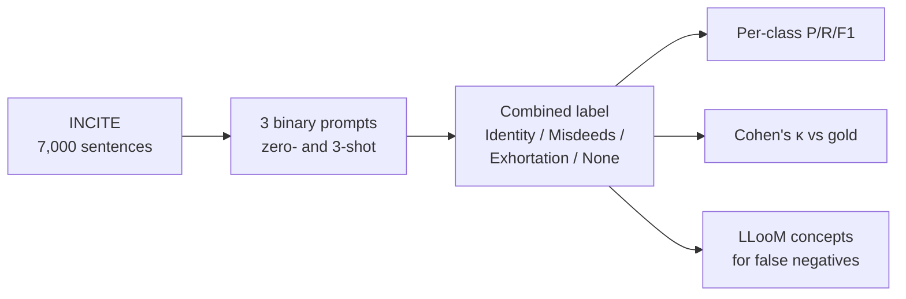

# LLM annotation of inciting speech (INCITE)

Code for the INCITE part of *Are LLMs Good Annotators? Effectiveness and
Biases of LLMs in Malicious Speech Annotations* (Vishnu Kalaparty, Yuvaraj
Radhakrishnan, Tarun Ajitkumar, Vaibhav Garg; all authors contributed equally;
under review). The HateXplain (hate speech) code is in
[classify_hateXplain_llm](https://github.com/vishnu-kalaparty/classify_hateXplain_llm).

> **Content warning:** the data and examples involve inciting and hateful text.

Each sentence is annotated with three binary prompts, one per incitement
strategy (Identity, Imputed Misdeeds, Exhortation). A sentence that none of the
three prompts flags is labeled None.



## Results (GPT-5-mini)

| Setting | Identity F1 | Misdeeds F1 | Exhortation F1 | None F1 | Macro F1 | Cohen's κ |
|---|---:|---:|---:|---:|---:|---:|
| 0-shot | 0.409 | 0.477 | 0.393 | 0.716 | 0.499 | 0.317 |
| 3-shot | 0.412 | 0.322 | 0.129 | 0.555 | 0.354 | 0.145 |

The metric files are in [`results/`](results).

## What is here

| Path | What it does |
|---|---|
| `classify_inciting.py`, `prompts.py`, `constants.py`, `data.py` | Run the three binary classifiers over INCITE and combine their labels |
| `inciting_few_shot_examples.json` | Three labeled examples per class for 3-shot prompting |
| `calculate_metrics.py` | Per-class precision, recall and F1, plus the macro average (Table II) |
| `calculate_ira_metrics.py` | Cohen's κ and Spearman's ρ against the gold labels (Table III) |
| `build_combined2_for_lloom.py`, `error_analysis/LLooM_Inciting_FN_FP.ipynb` | Concept analysis of model explanations for missed incitement (§V) |
| `error_analysis/ner_analysis.py` | Named-entity analysis of misclassified sentences |

## Setup

```bash
python3 -m venv .venv
.venv/bin/pip install -r requirements.txt
cp .env.example .env    # add your OpenAI key
```

Place the INCITE spreadsheet at `INCITE-Dataset.xlsx` in the repo root. The
dataset is from Garg et al., *Understanding Inciting Speech as New Malice*,
IEEE Transactions on Computational Social Systems 12(3), 2025, and is not
redistributed here.

## Running

```bash
python classify_inciting.py          # zero- or 3-shot is set by ENABLE_FEW_SHOT in constants.py
python calculate_metrics.py
python calculate_ira_metrics.py
python build_combined2_for_lloom.py --run-dir results/zero_shot
```

## License

MIT. See [LICENSE](LICENSE).
